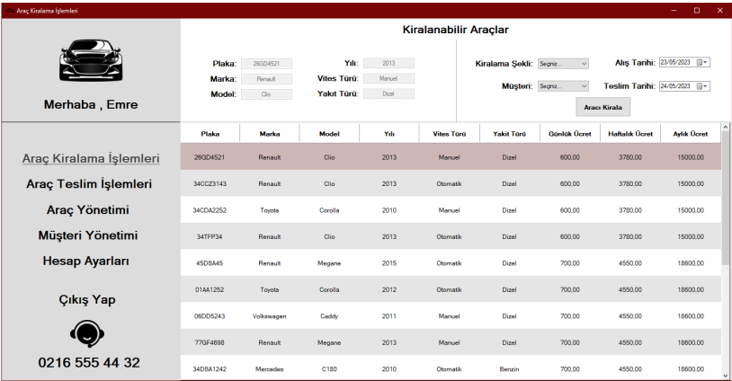
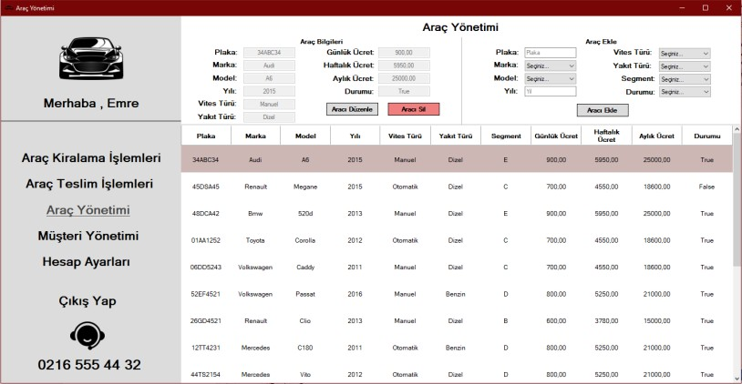
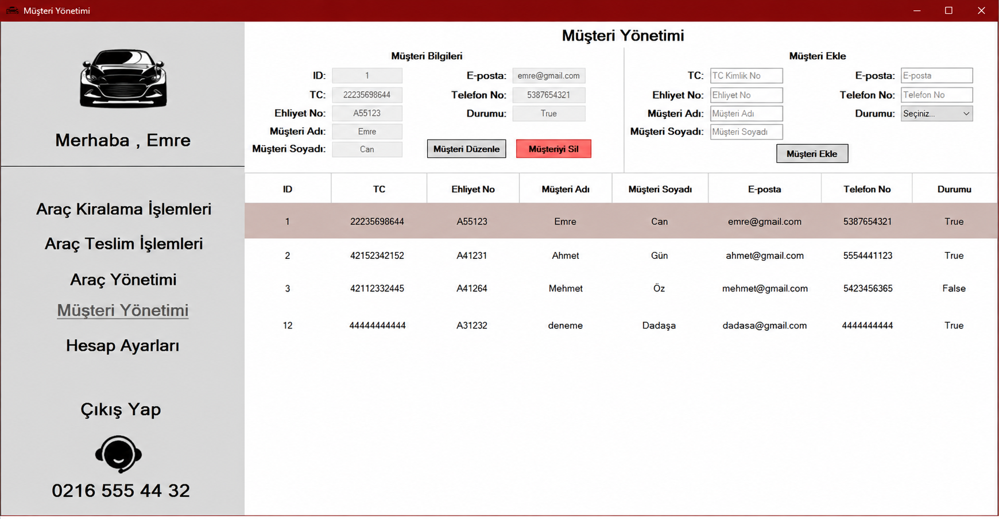
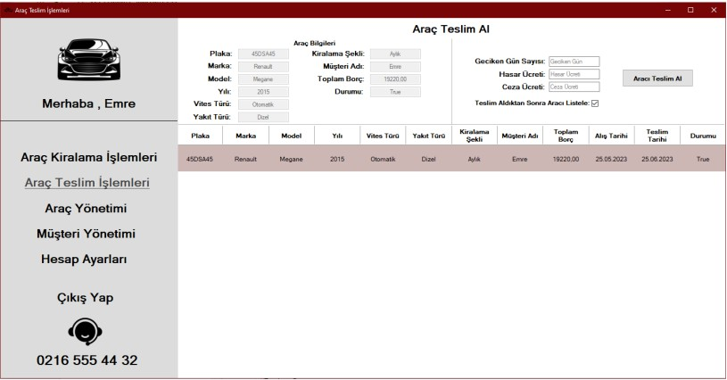
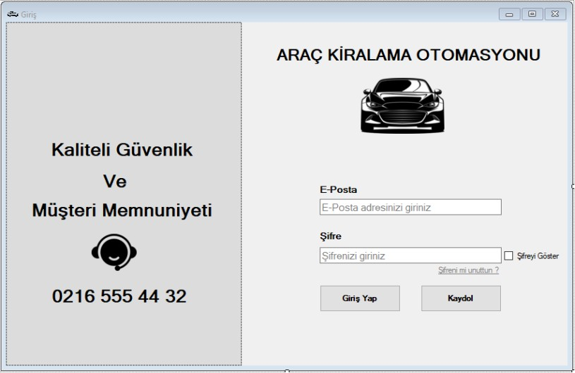
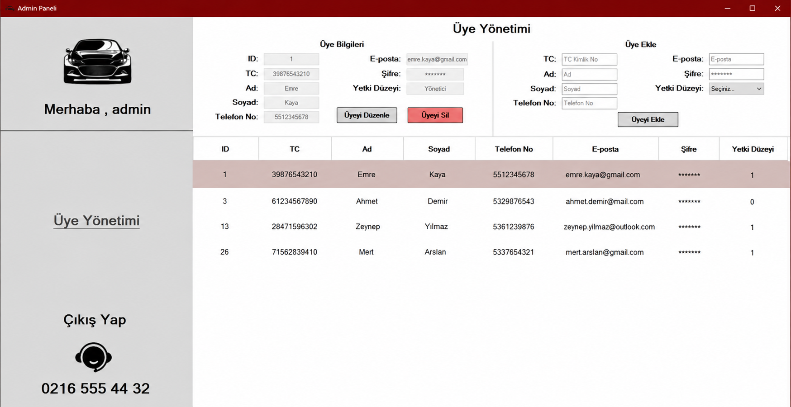

# Car Rental Management System

**A desktop application for managing everyday car rental operations.** Built with C#, Windows Forms, and Microsoft SQL Server as an academic project.

<p>
  
  
  
  
</p>

[English](#english) · [Türkçe](#türkçe) · [Screenshots](#screenshots) · [Original report](./Analiz%20Raporu.pdf)

## Screenshots

The following screenshots were extracted from the **original project analysis report**. They show the application's existing UI, without redesign or generated mockups.

| Car rental / Araç kiralama | Vehicle management / Araç yönetimi |
|:---:|:---:|
|  |  |

| Customer management / Müşteri yönetimi | Vehicle return / Araç teslimi |
|:---:|:---:|
|  |  |

<details>
<summary><strong>More screens / Diğer ekranlar</strong> (Login and Admin)</summary>

| Login / Giriş | Admin / Yönetici |
|:---:|:---:|
|  |  |

</details>

---

## English

### Overview

This Windows desktop application was developed to organize rental agency workflows and related records through a graphical interface backed by SQL Server. It includes separate screens for vehicle rentals, vehicle returns, vehicle and customer management, and user administration.

### Features

- **Authentication:** Login, user registration, and password recovery screens.
- **Rental workflow:** View vehicles and enter rental information.
- **Returns:** Track and process vehicle deliveries/returns.
- **Vehicle records:** View, add, edit, and remove vehicle entries.
- **Customer records:** View and manage customer information.
- **Administration:** Dedicated administrator screen and account settings.

### Tech stack

| Component | Technology |
|---|---|
| Language | C# |
| Desktop UI | Windows Forms |
| Runtime | .NET Framework 4.7.2 |
| Database | Microsoft SQL Server (MSSQL) |
| Development environment | Visual Studio |

### Project layout

```text
car-rental-management-system/
├── AracKiralamaOtomasyon.sln
├── AracKiralamaOtomasyon/     # Windows Forms app, designers, datasets, resources
├── Analiz Raporu.pdf          # Original academic analysis report
├── assets/
│   └── screenshots/          # UI captures extracted from the report
└── README.md
```

### Running locally

> **Legacy project:** The code was originally configured for the development machine. This repository has not been verified as a turnkey installation on a clean machine.

1. On **Windows**, install Visual Studio with .NET desktop development support and the **.NET Framework 4.7.2 targeting pack**.
2. Open `AracKiralamaOtomasyon.sln`.
3. Provide the SQL Server database and schema expected by the project (database name in code: `Db_AracKiralama`).
4. Update the **machine-specific** SQL connection strings in the form source files to match your SQL Server instance (original server: `DESKTOP-BTIS91A`).
5. Check any email-related configuration if testing account recovery, then build and run in Visual Studio.

The report documents database tables and UI workflows, but is **not** a guaranteed database setup script. Do not use actual personal or production data for initial testing.

### Future improvements

- Move SQL Server connection settings into configuration.
- Publish a reproducible SQL schema and sample-data setup.
- Review password handling, email configuration, and input validation.
- Separate business logic and database access from the Windows Forms UI.
- Add repeatable tests and modernize the framework when time permits.

---

## Türkçe

### Proje hakkında

Bu proje, bir araç kiralama işletmesinin günlük işlemlerini ve kayıtlarını yönetmek amacıyla **C# Windows Forms** ve **Microsoft SQL Server** kullanılarak geliştirilmiş bir masaüstü uygulamasıdır. Mevcut uygulama, kiralama ve teslim işlemlerinin yanı sıra araç, müşteri ve kullanıcı yönetimi ekranları içerir.

### Özellikler

- **Kullanıcı işlemleri:** Giriş, kayıt olma ve şifre sıfırlama ekranları.
- **Araç kiralama:** Araçları görüntüleme ve kiralama bilgilerini işleme.
- **Araç teslimi:** Kiralanan araçların teslim/iade süreçlerini yönetme.
- **Araç yönetimi:** Araç kayıtlarını listeleme, ekleme, düzenleme ve silme.
- **Müşteri yönetimi:** Müşteri bilgilerini görüntüleme ve düzenleme.
- **Yönetim:** Yönetici ekranı ve hesap ayarları.

### Kullanılan teknolojiler

**C# · Windows Forms · .NET Framework 4.7.2 · Microsoft SQL Server · Visual Studio**

### Yerel ortamda çalıştırma

1. Windows üzerinde Visual Studio ve **.NET Framework 4.7.2 geliştirme bileşenlerini** kurun.
2. `AracKiralamaOtomasyon.sln` dosyasını Visual Studio ile açın.
3. Uygulamanın beklediği `Db_AracKiralama` veritabanını ve ilgili tabloları SQL Server'da hazırlayın.
4. Kaynak kodda bulunan eski bilgisayara özel `DESKTOP-BTIS91A` SQL Server bağlantı dizelerini kendi ortamınıza göre güncelleyin.
5. Şifre sıfırlama gibi e-posta kullanan işlevleri denemeden önce gerekli ayarları kontrol edin; ardından projeyi derleyin ve çalıştırın.

> **Önemli:** Bu eski bir akademik projedir. Yalnızca depoyu klonlamak, veritabanı ve ortam ayarları tamamlanmadığı sürece uygulamanın çalışacağı anlamına gelmez.

### Proje raporu

Veritabanı tablolarının anlatımı, kaynak kod açıklamaları ve uygulamanın özgün ekran görüntüleri için **[Analiz Raporu.pdf](./Analiz%20Raporu.pdf)** dosyasına bakabilirsiniz.

### Gelecekte yapılabilecek geliştirmeler

- Veritabanı bağlantı ayarlarının merkezi yapılandırmaya taşınması.
- Kurulabilir SQL şemasının ve örnek verilerin eklenmesi.
- Parola güvenliği, e-posta ayarları ve doğrulamanın gözden geçirilmesi.
- Veritabanı işlemlerinin arayüz kodundan ayrılması.
- Testlerin eklenmesi ve kullanılan teknolojilerin güncellenmesi.

---

**Note / Not:** The original application's source code and UI have been preserved. Screenshots were extracted from the historical project report solely for documentation.
